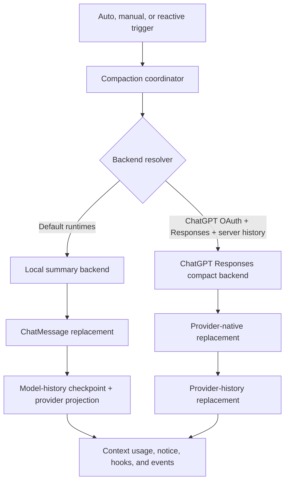

# Context Compaction Pipeline

| Field | Value |
|---|---|
| **Version** | 0.9.7 |
| **Status** | Draft |
| **Date** | 2026-10-29 |
| **Parent Specs** | [Session Core](session-core.md), [Model Runtime](model-runtime.md), [Canonical OpenAI Responses Provider History](responses-provider-history.md), [OpenAI Subscription Auth](openai-subscription-auth.md) |

Purpose: Define the backend-neutral context compaction pipeline. This spec owns backend selection,
replacement domains, trigger phases, failure behavior, context usage, and recovery. Session Core
owns lifecycle and public events. Provider specs own wire formats and native history representation.

## Goals and non-goals

The pipeline:

- selects a compaction backend from the thread's effective model runtime and history mode;
- supports automatic, manual, and reactive compaction through one orchestration contract;
- supports both provider-neutral `ChatMessage` replacement and provider-native history replacement;
- preserves a provider-neutral history that can be used after a provider or protocol change;
- installs every successful replacement as an atomic context-window transition;
- keeps threshold accounting valid when a provider-native replacement cannot be represented as
  `ChatMessage`.

The provider-native backend targets ChatGPT OAuth with server-managed OpenAI Responses history.
Non-goals:

- decoding or summarizing an opaque provider compaction item locally;
- converting one provider's native records directly into another provider's records;
- provider-native compaction for client-managed history;
- a local fallback after a selected provider-native backend fails;
- Responses `context_management` server-side compaction on ordinary `/responses` requests.

## Core invariants

| Invariant | Requirement |
|---|---|
| **Neutral history remains available** | A provider-native replacement never replaces, truncates, or synthesizes the canonical `ChatMessage` history. |
| **One replacement domain** | One successful attempt has either a neutral or provider-native authoritative replacement. Projecting a neutral replacement into active provider history is derived state, not a second compaction result. |
| **No cross-backend fallback** | Once backend selection succeeds, an error from that backend is a compaction failure; no other backend is invoked. |
| **Provider ownership** | A provider adapter owns capture, validation, estimation, and installation of its native history. Generic compaction code does not interpret provider item types. |
| **Canonical provider output** | A standalone compact response is installed as a complete ordered window. Unknown and retained items remain in the returned order. |
| **Request-shape parity** | A provider-native compact request derives model, instructions, tools, reasoning, and other supported controls from the same mapping path as a normal provider request. |
| **Atomic installation** | A replacement becomes live only after its authoritative recovery record is durable. A provider-native record also carries the next context-window identity; derived state-store projections are reconciled from it. |
| **Private provider state** | Provider item JSON and encrypted content are recovery state. Events, search, export, and ordinary diagnostics never expose them. |

## Architecture

The coordinator selects one backend; each backend returns its authoritative replacement domain.

An attempt carries its trigger (`Auto`, `Manual`, or `Reactive`), phase, immutable neutral history,
request options, context estimate, and any provider-native capability. Trigger and phase are distinct.
A successful result is either **neutral** (ordered model-visible messages) or **provider-native**
(protocol, ordered native items, covered message count and Turn, and replacement token estimate).

The provider owns read-only capture, replacement validation and installation, and native context
estimation. Capture may preview an uncovered neutral tail but never mutates live history or emits
rollout records.

## Backend selection

Selection is internal and automatic, evaluated from the effective runtime at the start of each
attempt. It is not a user configuration field.

| Runtime | History mode | Backend |
|---|---|---|
| ChatGPT OAuth + `openai-responses` | Server-managed | `chatgpt_responses_compact` |
| API-key OpenAI Responses | Server-managed | Local summary |
| Any non-Responses protocol | Server-managed | Local summary |
| Any runtime | Client-managed | Request-local compaction only; thread-level manual compaction is unavailable |

Changing provider, model, protocol, or authentication method invalidates the cached backend
selection along with the thread agent and compaction runtime.

If the selected provider-native capability is missing or corrupt, the attempt fails with
`provider_compaction_unavailable`.

## Orchestration

Each attempt follows this order:

1. Resolve the effective runtime, trigger, phase, and exactly one backend.
2. Evaluate the active context using a valid provider anchor or the selected backend's estimator.
3. Run `PreCompact`. A blocked hook skips or fails the attempt.
4. Capture an immutable input from the selected backend.
5. Execute the backend once. Backend-internal bounded authentication recovery is not another
   compaction attempt.
6. Validate the result without mutating live history.
7. Persist one replacement domain, then install it from the committed recovery record.
8. Invalidate pre-replacement token anchors and request snapshots for the replaced domain.
9. Save replacement context usage, emit the terminal event and notice, then run `PostCompact`.

Manual compaction holds thread maintenance for the complete sequence. Auto and reactive compaction
remain serialized by the active Turn and Session Gate.

## Automatic trigger phases

Automatic compaction runs at three boundaries of a Turn. Each phase fixes what the compaction
input contains and which Turn the resulting replacement covers. A replacement never covers a Turn
later than its covered Turn: rollback that removes later Turns keeps it, and rollback that removes
the covered Turn discards it.

| Phase | When | Input | Covered Turn |
|---|---|---|---|
| **PreTurn** | At Turn start, after the persisted model history is loaded and instruction or guidance reconciliation is applied, before the Turn's context items and user input are appended. | The persisted neutral history only. | The newest surviving terminal Turn (`Completed`, `Failed`, or `Cancelled`); the current Turn when the Thread has no terminal Turn. |
| **MidTurn** | Every sampling boundary inside the Turn, including the first one when the new input itself crosses the threshold. | The complete sampling list. | The current Turn. |
| **PostTurn** | After the final assistant response, before the Turn reaches its terminal status. Requires `Compaction.PostTurnCompactThresholdPercent` above zero and a post-response active context at or above the auto threshold or `EffectiveContextWindow × percent / 100`. Skipped while the Turn is cancelling or queued inputs are pending. | The complete Turn history including the final response. | The current Turn. |

After a PreTurn replacement, the Turn's context items and user input are persisted as the current
Turn's model-history batch behind the checkpoint, so a later rollback of that Turn removes only the
batch. A PostTurn replacement is committed together with the Turn's terminal state. A PostTurn
failure emits `compactFailed`, keeps the completed Turn, and never fails it.

## Local summary backend

The local backend:

- may clear old tool-result content through cold-cache microcompaction;
- replaces an older prefix with a handoff summary (partial compaction);
- may use a full-history summary for manual compaction when no partial prefix exists;
- returns a neutral replacement, which Session Core persists as a model-history checkpoint before
  making it live; an active Responses adapter maps it once into a new provider-history generation.

The summary request consumes only the snapshot or trimmed message list supplied by the pipeline. It
may retain the active thread identity and prompt-cache routing, but it never reads from or appends to
the active Responses provider-history generation.

### Local summary contract

The synthetic handoff summary is installed with the User role, establishing an input boundary before
the retained tail rather than impersonating an Assistant response that lacks provider-required
reasoning.

Context compaction is a short-term context-window optimization, not long-term memory.

- The summary is a handoff for the next model-visible history. It preserves only the current task,
  key decisions, important files read or changed, critical errors and fixes, constraints, and
  concrete next steps.
- Summary prompts target a bounded output budget. They do not request a chronological analysis of
  every message, a separate `<analysis>` drafting block (one returned anyway is stripped), a list of
  all user messages, or full code snippets; a minimal excerpt is allowed only when exact text is
  required to continue.
- Every compaction request uses the compact-specific `MaxOutputTokens` budget from configuration,
  never the ordinary turn output budget, including snapshot forks that preserve the cache-sensitive
  input prefix. A returned summary over the compact-specific hard budget is `compact_summary_too_long`
  and falls back to a non-cache path or reports `compactFailed`.
- A cache-sharing snapshot or context-usage anchor is usable only while its captured messages remain
  a prefix of the current canonical history and its request-shape fingerprint matches. Any
  successful history replacement (compaction, rollback, deletion) invalidates older snapshots and
  anchors.
- A maintenance fork attempts the cache-sharing snapshot request only when its estimate fits the
  maintenance input budget. An over-budget estimate, or a provider rejection conservatively
  classified as prompt-too-long or context overflow, returns `maintenance_snapshot_too_large` and
  falls back to a trimmed non-cache path when one exists. An otherwise empty response containing
  provider error content returns `maintenance_empty_error_response` and also falls back. Other
  provider, authentication, rate-limit, model, or request-shape errors are never reclassified as
  context overflow.
- Cancellation, provider or network timeout, and overlong summaries are recorded in traces with a
  terminal maintenance-fork response. Manual compaction maps user cancellation to
  `compactCancelled`, and timeout or an overlong or invalid summary to `compactFailed` with a
  machine-readable `message`.

## ChatGPT Responses compact backend

### Activation

The backend is active only when the effective runtime uses `AuthMethod = chatgptOAuth`, the
effective protocol is `openai-responses`, the thread uses server-managed history, and its provider
history is active and replayable. API-key Responses runtimes do not use it.

### Transport and request

The backend uses the configured OAuth `POST /responses` streaming transport, including the
standard or Lite dialect selected for ordinary sampling. It appends exactly one request-local
`{"type":"compaction_trigger"}` after the immutable native input snapshot; the trigger is never
persisted. The Responses mapper and OAuth pipeline own tools, instructions, reasoning, service tier,
prompt cache, client metadata, streaming flags, and conversation routing. The request kind is
`compaction`.

The compact request must fit the effective context window, because it carries the same history
that may have just been rejected. When the provider-native estimate of the request exceeds that
window, the backend shrinks the request only, never the captured input:

1. From the newest item backward, it replaces the output of each tool result with a fixed
   truncation notice until the request fits or a non-tool-result item is reached.
2. If the request still exceeds the window, it drops the oldest items through the next user message
   boundary, keeping tool calls paired with their results, until the request fits or only the newest
   user-message segment remains.

Coverage and retained messages still derive from the complete captured input.

The backend consumes raw SSE events and never passes compaction through the normal chat adapter or
tool loop, which would append provider outputs or execute tools in the live conversation.

### Completion and replacement

A successful stream reaches `response.completed` after exactly one `compaction` item has been
observed in `response.output_item.done`. Missing or duplicate compaction items, malformed events,
`response.failed`, `response.incomplete`, errors, and premature EOF fail the attempt. A provider error
event fails it with the provider error code. Extra output
items are ignored and never executed. The compaction item's unknown fields and encrypted content are
preserved as raw JSON.

The next native window is the captured input's user messages and client developer context, in
order, followed by the new compaction item. Old reasoning, assistant output, tool calls and results,
old compaction items, and request-local tool/instruction injection are excluded. Retained messages
are limited to 64,000 estimated tokens using the provider-native estimator, including media,
selected newest first. A boundary message may truncate text on Unicode boundaries but never splits
media payloads; whole content items are removed when needed. Unknown fields in retained messages
survive unchanged except for the boundary content. The replacement estimate includes this complete
window and request overhead.

Completion metadata (response id, usage, duration, terminal status, and protocol version) is
diagnostic only.

## Provider-native trigger phases and coverage

`CoveredMessageCount` describes how much of the neutral sampling list is represented by the
provider-native replacement; `CoveredThroughTurnId` describes the latest Turn boundary it represents.
They are coverage boundaries, not a claim that provider records can be converted back into neutral
messages. The message count is the active runtime cursor; the durable replacement stores the Turn,
and cold recovery derives the neutral cursor from that Turn boundary and later surviving
provider-history appends.

The sampling list includes persisted AGENTS.md instruction messages and uses the same history
sanitizer as ordinary sampling. Removing AGENTS.md updates is a local-summary policy applied after
backend selection; it never shortens native coverage. Manual context usage estimates include the
complete provider-visible history, and the replacement estimate after manual compaction keeps the
request overhead (instructions and tool schemas) as automatic compaction does.

Reactive compaction uses the failed turn's final captured sampling snapshot, including sanitizer
repairs. The failed turn remains failed after compaction; the user can resubmit against the
compacted history.

| Phase | Compact input | Coverage after installation |
|---|---|---|
| **PreTurn** | Current committed native generation. Excludes the new user message that has not entered provider history. | Retains the prior native message count and covered Turn. The new user tail is appended exactly once by ordinary request preparation. |
| **MidTurn** | Current native generation plus a read-only mapping of the active Turn's uncovered tool/guidance tail. | Covers the complete current sampling list and current Turn. |
| **PostTurn** | Current native generation plus a read-only mapping of the complete current Turn, including the final assistant response. | Covers the complete current sampling list and current Turn. |
| **Manual** | The current persisted generation after protocol-return alignment, if needed. | Covers the full neutral session and latest terminal Turn represented by that generation. |
| **Reactive** | The exact native input rejected by the provider for context overflow; the compact request is fitted to the window. | Covers that submitted sampling list and the failing Turn. |

If manual compaction finds that non-Responses Turns occurred after the stored Responses generation,
Session Core first performs a `protocol_return` replacement from neutral history, and the backend
then compacts that aligned generation.

A pre-turn attempt with no committed native prefix returns `Skipped` with
`provider_compaction_empty_input`. It does not summarize a new user message by itself.

## Replacement installation

### Neutral replacement

A neutral replacement:

1. persists the replacement `ChatMessage` checkpoint and covered Turn;
2. replaces the in-memory neutral session;
3. advances the context window from the committed checkpoint;
4. rebuilds provider-native history from the neutral replacement when the active provider requires
   it.

When the replacement is installed between sampling steps of a Turn, the next request and the rebuilt
provider-native history are built from the installed replacement, including its instruction item.

### Provider-native replacement

A provider-native replacement:

1. allocates the next context-window/generation identity without publishing it;
2. appends one `provider_history_replaced` baseline containing the complete client-built
   replacement, coverage Turn, protocol, generation, and reason `remote_compaction`;
3. treats that durable rollout record as the replacement commit point;
4. publishes the new provider generation and exact context-window identity only after the append
   succeeds;
5. updates the `thread_context_windows` state-store projection to the committed identity;
6. leaves the in-memory and persisted neutral `ChatMessage` history unchanged and appends no
   model-history checkpoint.

Refreshing AGENTS instructions after installation appends a world-state update to the active native
generation rather than projecting the neutral transcript into a new generation. Neutral replacements
instead install the current instruction snapshot after filtering historical AGENTS updates from the
summary.

The rollout replacement is authoritative because it contains its own context-window identity.
`thread_context_windows` is a routing projection, not a second commit record. Cold recovery selects
the newest valid replacement, uses its identity for the active Responses scope, and reconciles a
stale projection before the next request. A projection write failure after the rollout commit does
not make the previous generation live again. If the rollout append fails, the new generation never
becomes live and replay continues from the previous valid generation.

Both replacement kinds invalidate continuation tokens, prompt request snapshots, and provider usage
anchors that refer to the replaced request boundary. Both produce the `partial` successful outcome,
`compacted` event, and persistent compaction `SystemNotice`.

## Context usage

Neutral history cannot estimate a provider-native compacted window because the opaque item has no
semantic `ChatMessage` representation. When a provider-native generation is active, threshold
evaluation uses a provider-native estimator.

The OpenAI Responses estimator includes:

- base instructions and final tool/request controls;
- serialized model-visible bytes for ordinary response items;
- decoded-payload estimates for `reasoning`, `compaction`, and `context_compaction`
  `encrypted_content`;
- adjusted image, audio, and encrypted tool-output payload costs;
- the mapped token estimate of any neutral tail not covered by the native generation.

After installation, Session Core saves the result as a context usage estimate with source
`provider_compacted_estimate` and `isEstimate = true`. This estimate may drive automatic compaction
because it describes the active provider generation. The next real provider usage snapshot replaces
it.

A persisted provider usage value that does not match the active generation is display-only and never
triggers compaction. While an active native replacement exists, the coordinator never estimates the
complete neutral transcript instead.

Without provider usage, the local context estimate counts the request's base instructions and tool
schemas as well as the history.

`thread/contextUsage/read` splits the current usage into categories: instruction sections and tool
schemas are rough local estimates captured with each sampled request and kept across compaction, and
messages take the remainder of the current usage.

## Failure and cancellation

| Failure | Stable reason | Behavior |
|---|---|---|
| Native capability absent or corrupt | `provider_compaction_unavailable` | Fail selected backend; no local fallback. |
| Empty phase input | `provider_compaction_empty_input` | Skip unless the caller's blocking policy requires failure. |
| Invalid or empty response | `provider_compaction_invalid_response` | Fail selected backend; keep old generation. |
| Authentication, transport, or provider error | The provider error code, such as `context_length_exceeded` from an SSE `error` or `response.failed` event, or `provider_compaction_failed` | Fail selected backend after normal bounded OAuth recovery. The provider message is kept in the failure message. |
| Replacement rollout append failure | `provider_history_persist_failed` | Keep old live generation and fail the attempt. |
| Context-window projection is stale after commit | State-store diagnostic | Keep the committed generation live and reconcile before the next request. |
| User cancellation during manual compaction | `cancelled` | Emit `compactCancelled`; install nothing. |

Failure policy is trigger-specific:

- auto failure below the blocking limit emits `compactFailed` and may continue to the original
  sampling request;
- auto failure while the context is still above the blocking limit fails the Turn with
  `agent_context_compaction_failed` instead of sending the main provider request;
- manual failure returns `outcome = "failed"`;
- reactive failure preserves the original context-overflow failure;
- reactive success still fails the Turn after installing the repaired history and asks the user to
  resend the message.

The compaction failure tracker is backend-specific: failures from one backend never trip another
backend's circuit breaker.

## Recovery and protocol changes

- **Cold resume:** replay the newest valid provider replacement and later surviving entries. The
  opaque output is sent directly to the next Responses request.
- **Rollback:** reject a replacement whose covered Turn no longer survives, then select an older
  valid generation. PreTurn and PostTurn replacements cover only terminal Turns, so rolling back
  the newest Turn to edit and resend its input keeps them; a MidTurn or reactive replacement
  covering the removed Turn is discarded.
- **Fork:** copy an exact compatible provider prefix for whole-Turn forks. Partial or incompatible
  forks materialize from neutral history.
- **Leave Responses:** retain provider history but use neutral history for the new protocol.
- **Return without intervening Turns:** reuse the valid Responses generation.
- **Return after non-Responses Turns:** create a new `protocol_return` generation from neutral
  history. Another provider's records are never translated.
- **Ephemeral thread:** apply the same state transitions in memory and persist them only through the
  normal promotion path.

The neutral transcript is the semantic interoperability fallback. It does not reproduce the token
savings or hidden state of an opaque provider compaction item.

## Observability and privacy

Compaction traces may record:

- backend id, trigger, and phase;
- request and output item counts;
- serialized byte counts and token estimates;
- context-window/generation ids;
- provider request id, duration, and terminal status;
- stable failure reason.

Traces, logs, context search, previews, and ordinary export never record provider item bodies,
encrypted content, OAuth credentials, or compact request instructions. Protected-data handling for
explicitly enabled HTTP capture applies equally to compact traffic.

`PreCompact` and `PostCompact` run once for the logical compaction attempt. Bounded OAuth 401
recovery and transport retries do not emit additional hook or Session Core lifecycle events.

## Public behavior

- `Compaction.PostTurnCompactThresholdPercent` (0–100; `0` disables turn-end compaction) is the
  pipeline's configuration field.
- `thread/compact/start` starts manual compaction.
- `outcome = "partial"` reports a successful summary-producing or provider-native replacement.
- `compacting` is followed by one terminal compaction event.
- Successful partial or provider-native replacement adds a persistent `SystemNotice`.
- `contextUsage.source` is an extensible diagnostic string.

Clients do not need to know which backend produced the replacement.
