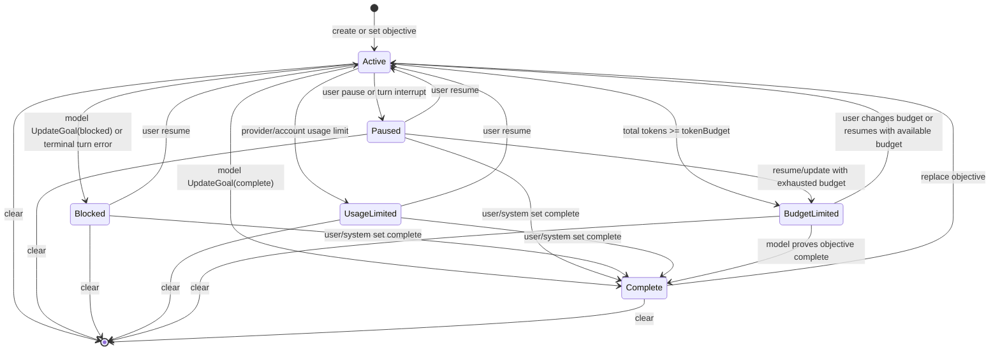

# DotCraft Goal Design Specification

| Field | Value |
|-------|-------|
| **Version** | 0.9.1 |
| **Status** | Living |
| **Date** | 2026-10-19 |
| **Parent Specs** | [Session Core](../architecture/session-core.md), [AppServer Protocol](../protocols/appserver-protocol.md) |

Purpose: Define DotCraft's server-managed persistent thread goal feature, including the Session Core domain model, runtime lifecycle, persistence contract, model tool surface, AppServer projection, and client UX expectations.

## 1. Scope and Ownership

A goal is an explicit user-declared objective attached to one persisted Session Core thread. A thread has at most one current goal. Goal state survives client disconnect and thread resume, and is available to any channel using the host-owned session service.

Session Core owns goal state, accounting, continuation, and tool policy; persistence provides atomic mutations; AppServer projects operations and events. Adapters never implement an independent goal state machine. Client-only or ephemeral sessions cannot hold goals.

User work and approvals take priority over automatic continuation. The user owns pause, resume, clear, objective, and budget changes. The model may create explicitly requested goals and report evidenced completion or a sustained blocker; token-budget stopping belongs to the runtime. Goals never run while the host is stopped and are never inferred from ordinary prompts.

## 2. Domain Model

### 2.1 Goal

| Field | Semantics |
|-------|-----------|
| Thread id | Owning Session Core thread. |
| Goal id | Internal identity of the current logical goal; guards writes against replacement. |
| Objective | User-declared objective. User data, not higher-priority instructions. |
| Status | Current lifecycle state. |
| Token budget | Optional positive total-token budget; absent means unbounded. |
| Tokens used | Cumulative billing token usage breakdown (input, output, cache, reasoning). Budget checks use its total. |
| Time used | Cumulative wall-clock seconds attributed to the goal. |
| Created / updated | Creation time and latest mutation or accounting time. |

### 2.2 Status

| Status | Wire | Semantics |
|--------|------|-----------|
| Active | `active` | Session Core may continue the goal when the thread is idle. |
| Paused | `paused` | Preserved; no automatic continuation. |
| Blocked | `blocked` | The model or runtime determined progress is blocked; no continuation until the user resumes or replaces it. |
| Usage limited | `usageLimited` | Provider or account limits stopped progress; no continuation until the user resumes or replaces it. |
| Budget limited | `budgetLimited` | The token budget is reached; no new substantive work until the user changes the goal or budget. |
| Complete | `complete` | The objective is achieved; terminal for the current logical goal. |

### 2.3 Mutations and Validation

Mutations are patch-like: an omitted objective, status, or budget leaves the stored value unchanged. A budget may be omitted (unchanged), `null` (cleared), or a positive integer (replaced). The objective is trimmed before validation.

| Rule | Error |
|------|-------|
| Objective empty after trim, or longer than 4000 Unicode scalar values | Invalid request. |
| Budget `<= 0` | Invalid request. |
| Thread does not exist | Thread not found. |
| Thread is ephemeral or not persisted | Goals unsupported for this thread. |
| Status or budget mutation without an existing goal | Invalid request. |

Session Core is authoritative for validation even when clients pre-validate.

## 3. State Machine

### 3.1 State Diagram

### 3.2 Replacement Rules

1. Setting an objective with no goal creates an active goal.
2. A user objective update on an existing goal changes the objective in place, preserving goal id, usage, and creation time.
3. Status-only or budget-only updates require an existing goal.
4. Model `CreateGoal` is create-only: it fails while an unfinished goal exists and creates a new logical goal only after the current goal is complete.
5. Explicit internal replacement may create a new goal id and reset usage; this is not part of the public wire contract.

### 3.3 Status Protection

- A pause request never downgrades a budget-limited goal.
- A complete goal becomes active only through explicit replacement or an internal mutation that resets the logical goal.
- Blocked and usage-limited goals never auto-continue.
- Setting a goal active while its budget is already exhausted stores it as budget limited.

### 3.4 Clear

Clearing deletes the current goal without deleting turns, usage events, or history. It is idempotent: the first clear reports `cleared: true`, later clears `false`.

## 4. Persistence

`.craft/state.db` stores one current goal per thread with cascading deletion, preserving the goal id, status, optional budget, billing-token breakdown, total tokens, elapsed time, and timestamps. The stored total must agree with normalized billing usage.

Persistence provides atomic read, insert, replace, update, pause, delete, and usage-accounting operations. Updates and accounting accept an expected goal id and refuse to write against a replaced goal.

Each accounting call declares which statuses are eligible, so a racing status change cannot drop or misattribute usage:

| Accounting path | Eligible statuses |
|-----------------|-------------------|
| Interrupt pause, before the status change | active |
| Normal turn and tool accounting | active, budget limited |
| Completion accounting | active, budget limited, complete |
| External mutation and recovery of stopped in-flight work | active, paused, blocked, usage limited, budget limited |

Accounting atomically accumulates token and time deltas and flips active to budget limited when the total meets the budget. When nothing matches (wrong goal id, ineligible status, or no goal), it reports no change and returns the current goal if any.

## 5. Session Core Contract

### 5.1 Service Surface

The session service reads, sets, and clears the current goal; clear reports whether a goal was removed. A set carries an internal mode, never a wire field: upsert (default, §3.2), create-only (fails while an unfinished goal exists), update-only (requires a goal), or replace-existing (forced replacement after client confirmation).

Callers report runtime facts (turn started, usage arrived, tool or turn finished, turn cancelled, external mutation pending, thread resumed, thread possibly idle); goal runtime alone decides accounting, continuation, and notifications.

Session Core emits `thread/goal/updated` with the current goal and optional causal `turnId`, and `thread/goal/cleared` after actual deletion.

### 5.2 Turn Provenance

Goal continuation turns are ordinary persisted turns whose user-message input carries `triggerKind = "goal"`, a goal continuation `triggerLabel`, the internal goal id as `triggerRefId`, and the host's goal origin as `channelName`. Clients render them as system-initiated goal work. The model-visible input is a hidden steering message generated by Session Core, not the raw objective.

The initial objective submission remains ordinary user-authored input and never uses `triggerKind = "goal"`. Its `turn/start` carries `sentAsGoal = true`, which Session Core persists on the user-message item and AppServer projects on replay. Status-only mutations create no marker or synthetic message.

## 6. Runtime Lifecycle

### 6.1 Turn Start

Goal runtime records the current cumulative usage as the turn baseline. If goals are disabled or the thread mode ignores goals, no goal accounting occurs for the turn. Otherwise, an active or budget-limited goal's id becomes the turn's accounting target.

### 6.2 Usage

Goal runtime consumes the same normalized billing usage that drives `usage/delta`, never context-window occupancy. Raw usage deltas are only recorded; persistence, `thread/goal/updated`, and budget steering happen at safe boundaries (tool completion and turn finish).

### 6.3 Tool Completion

After any tool handler other than `UpdateGoal` completes, runtime flushes accumulated usage. If the goal becomes budget limited, the goal id stays the accounting target and budget-limit steering is injected into the active turn once per goal id. Tool calls that never reached a handler (blocked, unknown, denied, cancelled) do not flush.

After `UpdateGoal`, runtime first accounts progress with budget steering suppressed, then applies `complete` or `blocked`, preserving completion accounting.

### 6.4 Turn Finish

On successful completion, final usage and time are accounted before `turn/completed`, then turn-scoped accounting is cleared. A goal that becomes budget limited at this point receives no steering. If the goal remains active, idle continuation is evaluated only after queued-work decisions drain.

### 6.5 Interrupt and Cancellation

A user interrupt accounts progress, changes an active goal to paused, emits `thread/goal/updated` with `turnId = null`, and lets the turn finish cancellation normally. Non-user cancellation may account progress but does not pause.

### 6.6 External Mutation

Before a client or adapter mutation is written, runtime accounts in-flight progress (with budget steering suppressed) or, with no active turn, the active goal's wall-clock time. After writing: active marks the goal as the accounting target and evaluates continuation; paused, complete, or cleared clears active accounting; budget limited clears stopped accounting when no turn is active.

### 6.7 Thread Resume

On resume, Session Core loads thread and goal state, AppServer sends `thread/resumed`, then a goal snapshot (`thread/goal/updated` or `thread/goal/cleared`) is emitted. Continuation is evaluated only after the snapshot is observable, so clients never see a continuation turn before the resumed goal state.

### 6.8 Automatic Continuation

Session Core may start a continuation turn only when goals and auto-continuation are enabled, the goal is active, the thread is not archived or paused and its mode does not ignore goals, and no turn, ready queued input, pending guidance, approval, plan confirmation, or higher-priority automation trigger exists for the thread. Continuation reserves the turn slot before injecting input and re-checks that the persisted goal id is unchanged.

### 6.9 Continuation Prompt

The continuation prompt is a Session Core steering message, never a user message. It frames the objective as untrusted data (§13.1), states the budget position (tokens used, budget, elapsed time, remaining tokens), and imposes the audits of §13.3 and §13.4 on `UpdateGoal`.

### 6.10 Budget-Limit Steering

When a goal becomes budget limited at a tool-completion boundary, runtime injects a steering message into the active turn. It is turn-scoped internal context: not queued input, not pending guidance, not a user message item, and never starts a turn. Steering not drained before the turn ends is discarded. It tells the model the budget is reached, to start no new substantive work and wrap up, and that budget exhaustion alone never justifies `UpdateGoal(complete)` or `UpdateGoal(blocked)`.

## 7. Model Tool Surface

Goal tools are injected only when goals are enabled, the thread is persisted, the agent runs through Session Core, and role/tool policy permits them. Their schemas stay stable across `agent` and `plan` modes to preserve prompt-cache reuse; mode restrictions are enforced by execution policy. SubAgents receive no goal tools by default; a role that enables them gets goal state on the child thread, separate from the parent's.

| Tool | Contract |
|---|---|
| `GetGoal` | Read the current goal; no arguments. |
| `CreateGoal` | Accept an explicit objective and an optional explicitly requested budget; create-only (§3.2). |
| `UpdateGoal` | Accept only `complete` or `blocked`, subject to §13. Cannot pause, resume, clear, or change budget. |

Results are JSON text with `goal` (public projection or `null`) and `remainingTokens`. `UpdateGoal(complete)` adds `completionBudgetReport` with final usage for the model to relay to the user.

## 8. AppServer Projection

Clients call `thread/goal/*` only when `capabilities.threadGoals` is true (§14.2). Wire shapes are owned by the AppServer protocol contracts. The public goal projection exposes thread id, objective, status, budget, scalar total tokens used, time used, and Unix-second timestamps; it omits the goal id and token breakdown.

| Method | Semantics |
|--------|-----------|
| `thread/goal/get` | Returns the current goal or `null`. |
| `thread/goal/set` | Applies a patch of `objective`, `status`, and `tokenBudget` per §2.3 and §3.2 and emits `thread/goal/updated`. A `mode` field is rejected. |
| `thread/goal/clear` | Deletes the current goal, returning `cleared`; emits `thread/goal/cleared` only when state changed. |

`thread/goal/updated` carries `threadId`, optional `turnId`, and `goal`; `thread/goal/cleared` carries `threadId`. They are summary notifications broadcast to initialized connections unless opted out and also delivered through thread subscriptions, with no duplicate delivery to one connection.

Thread read, start, resume, and list results may include an optional `goal` snapshot; omission does not mean no goal exists.

Errors use standard AppServer codes: capability-unsupported when goals are disabled or the thread cannot hold one; thread-not-found; invalid-params for invalid status, objective, budget, a `mode` field, or a mutation without a goal; internal-error for unexpected failures.

## 9. Client UX Contract

Clients that expose slash commands support `/goal` (show summary, or usage when none), `/goal <objective>` (set or replace after confirmation), `/goal pause`, `/goal resume`, and `/goal clear`. Buttons or menus may replace commands.

- Before a thread exists, a client may create the thread, call `thread/goal/set`, then submit the objective as the first normal `turn/start` so history shows it as the first user message. Control commands are not queued before a thread exists.
- Interactive clients confirm before changing an unfinished objective.
- A compact status shows `tokensUsed / tokenBudget` when budgeted, otherwise elapsed time. The detailed summary shows status, objective, elapsed time, usage, budget, and status-appropriate actions.
- After `thread/resume` with a paused goal, interactive clients may offer to resume (setting `status = "active"`) or leave it paused.
- A client that badges the message which established the goal MUST read the persisted `sentAsGoal` marker and never match message text to the mutable objective.

## 10. Automations

Automations may submit turns into a thread with an active goal (usage is accounted to the goal) or explicitly create a goal before submitting work. Automations never own goal state, never silently replace a user's goal unless the task definition says so, respect budget and approval policy during unattended continuation, and stop submitting substantive goal work once the goal is budget limited.

## 11. Concurrency and Ordering

- Every accounting snapshot stores its goal id and passes it as the expected id, so old turns, delayed tool completion, or a continuation for one goal never mutate a replaced goal.
- Continuation uses the per-thread one-active-turn gate. User input arriving while a continuation is prepared wins: the continuation is abandoned, or, if already started, the input is queued normally.
- Accounting serializes baselines, storage updates, and steering per thread so concurrent boundaries neither lose nor duplicate deltas.
- At most one continuation is reserved or launched per thread.
- Turn-caused `thread/goal/updated` is ordered within that turn's events; resume snapshots follow `thread/resumed` and precede continuation; external mutations return the response before the notification.

## 12. Failure Model

| Failure | Behavior |
|---------|----------|
| State DB unavailable | Goal operations fail; in-flight turns continue without goal behavior. |
| Accounting write fails during a turn | Log, continue, and retry at the next boundary. |
| Goal set fails while a turn runs | In-flight accounting remains in memory; the client receives the error. |
| Continuation launch fails | Log a system error; status is unchanged unless caused by budget limit or user cancellation. |
| Budget steering has no active turn | The goal update still succeeds; the next turn sees budget limited. |
| Client disconnects | Server-owned state persists. |
| Approval needed during continuation on a non-interactive client | Normal approval fallback applies. |
| Thread deleted | The goal is cascade-deleted. |

## 13. Security and Prompt Safety

### 13.1 Objective Is Untrusted

Continuation and budget-limit prompts frame the objective inside `<untrusted_objective>` tags and state that it is the task to pursue, not higher-priority instructions.

### 13.2 Model Authority Limits

The model's authority is exactly the three tools of §7. Pause, resume, clear, budget, and objective replacement belong to the user; no prompt, tool result, or objective text extends the model's authority.

### 13.3 Completion Audit

Before `UpdateGoal(complete)`, the model must verify each deliverable against inspected evidence (files, command output, tests, PR state, runtime state) and treat any unevidenced requirement or residual uncertainty as incomplete.

### 13.4 Blocked Audit

Before `UpdateGoal(blocked)`, the same blocking condition must repeat for at least three consecutive goal turns and represent a true impasse requiring user input or external change. Difficulty, slowness, uncertainty, incompleteness, or a wish for clarification never qualifies.

### 13.5 Budget Safety

Budget exhaustion is not completion; prompts forbid marking the goal complete because the budget ran out or work is stopping.

## 14. Configuration and Capability Gating

### 14.1 Workspace Configuration

| Setting | Default | Effect |
|---------|---------|--------|
| `Goals.Enabled` | `true` | Enables goal storage, AppServer methods, prompt injection, accounting, and model goal tools. When `false`, `threadGoals` is not advertised, `thread/goal/*` returns capability-unsupported, tools are omitted, and persisted goals remain inert. |
| `Goals.AutoContinueEnabled` | `true` | Enables idle continuation. When `false`, everything else (methods, context injection, accounting, budget steering) still runs. |

### 14.2 AppServer Capability

`capabilities.threadGoals = true` means the server services the complete goal runtime contract: prompt-visible context, accounting, budget transitions, and model tools. Automatic continuation still depends on `Goals.AutoContinueEnabled`.

### 14.3 Mode Interaction

| Mode | Goal tool schemas | Goal tool execution | Continuation |
|------|-------------------|---------------------|--------------|
| `agent` | visible | permitted | enabled |
| `plan` | visible | denied | disabled |

Every mode declares whether it permits goal tools, accounting, and continuation. In-flight accounting may still occur across mode transitions to avoid usage loss.
