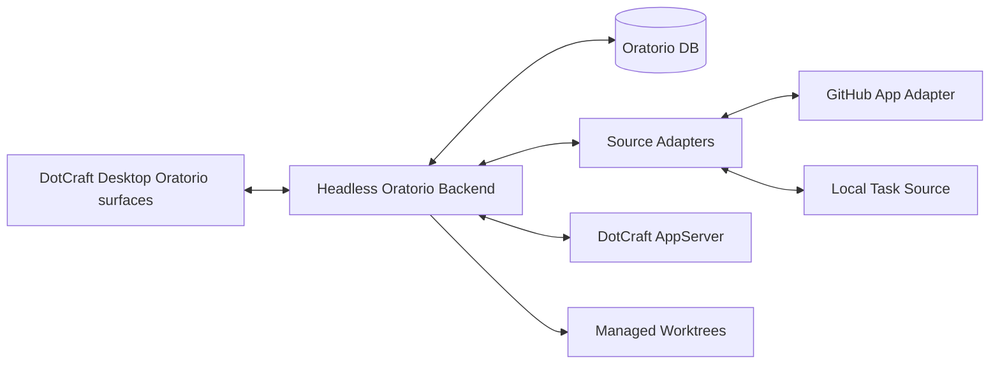
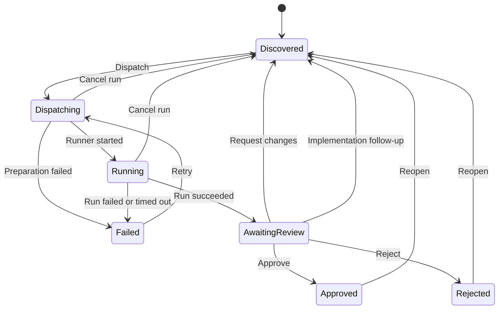

# Oratorio Design Specification

| Field | Value  |
| ----- | ------ |
| Version      | 0.9.3    |
| Status       | Living |
| Date         | 2026-10-24        |
| Parent Specs | [Automations Lifecycle](../automations-lifecycle.md) |

Oratorio is DotCraft's built-in agent project management product. It runs as
native DotCraft Desktop surfaces backed by a durable headless service. It owns
task state, comments, dispatch and review rounds, decisions, run summaries,
review, implementation and follow-up drafts, and the audit history of every
source write, and it drives DotCraft through AppServer. DotCraft remains the
agent runtime and workspace execution layer.

The native surface is intentionally narrow: Oratorio shows the board, task
cards and the task page. Detailed conversation, approval decisions, plan
inspection, file, terminal and preview views, and turn-by-turn interaction
belong in DotCraft Desktop.

This document is the canonical product and behavior contract for Oratorio.

## 1. Product Boundary

Oratorio is:

- a Project and Task board for assigning, tracking, and reviewing agent work;
- a long-running orchestration backend with durable state;
- a source adapter host for configured external trackers;
- an AppServer client that dispatches review and work rounds to DotCraft;
- the owner of multi-round operator feedback and review decisions.

Oratorio is not:

- a replacement for DotCraft Session Core, AppServer, or Hub;
- a separate Desktop application or third-party extension UI;
- a larger version of built-in Automations;
- a general cron or reminder system;
- the owner of low-level agent execution internals.

DotCraft built-in Automations intentionally has no task-level review gate. Local
task automation, scheduled execution, and built-in source-neutral dispatch stay
there unless a separate design contract explicitly moves behavior into Oratorio.

## 2. Architecture Contract

| Component | Contract |
| --- | --- |
| DotCraft Desktop surfaces | Show the board, the task drawer and page, source, run and write summaries, Settings, and operator board actions. They reach the backend only through Desktop's main process. |
| Headless backend | Owns orchestration, durable state, source sync, review transitions, AppServer dispatch, reconciliation and source writes. It exposes an API, a health check and a realtime stream, and serves no browser UI. |
| Oratorio database | Stores items, rounds, runs, comments, decisions, drafts, source snapshots, timeline events and source write records. |
| Source adapters | Normalize external and local work into Oratorio items and declare what they can read and write. |
| Provider adapters | GitHub (through a GitHub App) and GitLab (through project tokens) read issues and pull or merge requests and write comments, reviews, checks or statuses, and delivery, each write audited. |
| Local task source | Owns Oratorio-local tasks with comments, rounds, dispatch and decisions independent of any provider. |
| AppServer bridge | Starts or resumes DotCraft threads, submits turns, follows their events and records the outcome. |
| Worktree manager | Owns managed worktree locations, branch naming, concurrency limits, cleanup and restart reconciliation. |
| Desktop provider | Resolves the local Hub-managed or remote tunneled service, injects credentials and owns the realtime stream. |

Runtime topology:

- **Local service**: Desktop asks Hub to ensure the bundled Oratorio Server.
  Hub owns the process lifecycle; Desktop's main process owns API semantics,
  authentication and the realtime stream.
- **Remote Stack service**: Desktop connects to the official Stack through
  separate authenticated SSH tunnels for AppServer and Oratorio. The remote
  service owns orchestration, durable state, source sync, managed worktrees,
  dispatch, reconciliation and source writes.
- The Oratorio API is never exposed publicly. An optional webhook gateway
  may expose only the provider webhook endpoint.
- In a remote deployment the Oratorio backend and AppServer must reach the same
  repository workspace and managed worktrees at the same absolute paths. The
  local Desktop filesystem is never used for remote execution.
- Stack initialization creates a writable server configuration in the
  deployment's Oratorio state. Desktop Settings use the same revision and
  secret semantics in local and remote modes.

## 3. Lifecycle Contract

Oratorio state names are product states, not built-in Automations states.

Required lifecycle behavior:

- Every dispatch belongs to a durable, numbered round. Every run belongs to a
  round and records its runner, attempt, status, progress, heartbeat, summary
  and error when available.
- Approve and Reject end the current round until the item is reopened. Approve
  is allowed only after a completed run has moved the item to Awaiting Review.
- Timeline entries are operator-facing projections. Canonical state is the
  items, rounds, runs, comments, decisions, source snapshots and source write
  records.
- **Cancel run** is available only while an item is Dispatching or Running. It
  cancels the active run, closes the round as cancelled, clears the current run
  and returns the item to Discovered. It is a run action, not a decision; the
  next dispatch opens the next round.
- **Request changes** requires non-empty feedback, records it as a linked
  operator comment, closes the round as changes requested and returns the item
  to Discovered. The next dispatch opens the next round.
- **Re-review** (shown as Review new revision) is available for a GitHub pull
  request or GitLab merge request once its head commit differs from the one
  analyzed by the latest successful review analysis run. It records an internal
  decision, supersedes the current round, opens the next round and queues a new
  read-only review run. It writes no source decision; the new round drives the
  review check like any other review round.
- Repository **Auto Review** uses the same round semantics as Re-review (§7).
  It never writes a source decision.
- **Implementation Follow-up** returns an eligible originating issue or local
  task to Discovered and queues its next implementation round when its
  delivered pull or merge request gains unresolved published findings or new
  human review comments. It requires Awaiting Review, no active run, an open
  generated pull or merge request and remaining round budget. A disabled
  policy, a terminal or archived origin, a closed or merged generated change,
  or a clean latest review stops the loop; a reached cap is visible to the
  operator. Delivery reuses the same branch and review target (§6.2).
- Every GitHub pull request review round — first dispatch, Re-review, Auto
  Review and retry alike — drives one `oratorio/review` check run for the head
  commit under review. Oratorio marks it in progress when the round is queued
  and completes it as neutral when the review run succeeds, leaving merge
  ownership with the repository's collaborators. A later Oratorio approval,
  requested changes, rejection, cancellation or terminal run failure updates
  the same check to success, action required or failure. The check is a merge
  gate only when the repository requires it through branch protection or
  rulesets.
- **Archive** is available for any non-active item and preserves all history;
  **Reopen** returns an archived item to Discovered.
- Rejected and archived items are closed history. They project to the Cancelled
  task status and are not on the default Active board.
- Imported source comments are source context, not operator feedback, and never
  count as requested follow-up work on their own. The bounded exceptions are:
  - a pull request conversation command accepted through verified command
    intake, which may request a read-only review of an already configured
    repository; and
  - human review comments on the generated pull or merge request of an
    originating implementation item, which feed that item's next round under
    the gated Implementation Follow-up loop (§6.2, §8).

## 4. Domain and API Contract

The backend owns workflow truth. Clients render the lifecycle, capability and
validation state the API returns; they never invent domain transitions or treat
local presentation state as a domain change.

Domain records:

- **Item**: a source-neutral unit of work with a stable source identity, its
  lifecycle and source state, its check state, archive reason, and its current
  round and run.
- **Round**: one numbered review cycle of an item.
- **Run**: one execution attempt inside a round — what triggered it, the head
  commit it targets when relevant, its DotCraft thread and turn, its managed
  worktree, its outcome and its retry state.
- **Comment**: operator, source, agent or system text on an item and optionally
  a round. Its purpose — feedback, discussion question, discussion reply,
  source context or system note — decides whether it feeds the next round.
- **Discussion Turn**: a lightweight operator question to the agent (§6.3). It
  is not a run and creates no round.
- **Decision**: an operator action on a round: approve, request changes,
  reject, reopen or re-review.
- **Review Draft** and its findings: the structured result of a review run,
  published by Oratorio (§6.1). Published findings carry resolution state
  (§6.4).
- **Implementation Draft** and **Follow-up Draft** (§6.2).
- **Source Write**: one auditable provider write attempt (§5).
- **Timeline Event**: an append-only operator-facing record of sync, round,
  run, comment, decision, check, draft and write events.
- **Scheduler state** for Auto Review and Implementation Follow-up: per
  repository and per item, the enablement baseline, last observed and last
  queued heads, the follow-up round count, the last observed open findings and
  human comment time, and any visible skip, routing or cap state.

Every item in list and detail responses carries its **latest Oratorio result**:
none, no issues, findings, changes ready, delivered, or follow-ups. It is
derived from the newer of the item's latest review draft and latest
implementation draft, and from its follow-up drafts still waiting for a
decision; pending follow-ups take precedence over the rest. The result stays
until a newer draft replaces it, so the board shows it without extra requests.

The API is versioned and returns errors as a stable code with a readable
message. It covers:

- item list, detail and lookup by source identity;
- local task create, update, archive and reopen; source-backed archive and
  reopen;
- comments, discussion turns, dispatch, approve, request changes, reject,
  reopen and re-review;
- run detail;
- source status, sync, source write visibility and write retry;
- review draft detail with publication retry and discard, and resolve or
  reopen of a published finding (§6.4);
- DotCraft and AppServer status, workspace inventory, per-workspace health and
  dispatch diagnostics;
- capability status for managed worktrees, concurrency and runtime features;
- settings diagnostics, configuration reads and writes, secret updates and the
  change audit history.

Mutating calls validate lifecycle transitions at write time. Retrying a failed
source write retries only that write and never creates a new decision.

Server configuration writes are a local-admin capability, not a general remote
administration API; they require a trusted local boundary or operator
authentication. Writable settings are the source provider connections and
credentials, the DotCraft bridge, workspace routing, managed worktrees,
concurrency, retry, timeout and cleanup policy, implementation auto-dispatch
policy, the repository Auto Review list, and the Implementation Follow-up
policy (global switch, repository list and maximum follow-up rounds). Tokens,
webhook secrets and private keys can only be replaced or cleared, never read
back, and are stored encrypted. Auto-start commands and process arguments are
never writable through Settings. Every write records a redacted change audit
entry and takes effect without a restart: the server reloads configuration
before answering, so later reads, sync schedules and sync jobs see the saved
values immediately.

Workspace routes are declarative. A write validates each source project key and
requires a well-formed absolute path, but not that the directory is mounted,
registered with Hub or present. Availability belongs to workspace inventory and
run preparation: an unavailable route stays visible with its health reason and
fails runs with a stable reason (for example, not registered in Hub, or base
workspace missing). An unavailable route never blocks unrelated Settings
changes, rebinding or removal.

## 5. Source Contract

### Source provider model

Providers adapt reads, detail hydration, diff anchors, writes, Git delivery and
webhook verification into the shared item, review draft and source write model.
Each provider reports whether it is configured and authenticated, its read,
write and webhook availability, project counts, last sync and safe failure
reasons. Unsupported actions fail explicitly.

Every source project has a canonical key made of provider, instance and full
project path. Routing and allowlists use that key, so identical paths on
different providers or instances stay distinct. GitHub repositories may also be
configured as a plain owner and name. Display labels never replace canonical
keys.

Sync jobs are scoped to a provider and its projects. They report their trigger
(manual, webhook or scheduled), mode, status, per-project progress and counts
of imported issues, review targets, comments and skipped items. A failed
project does not block the others. Scheduled sync is off by default, first runs
one interval after it is enabled and does incremental work only; an active job
covers a due cycle, and missed intervals collapse into one catch-up. Full
repair is manual.

Source writes record their intent separately from the provider payload:
comments, review summaries and discussions, external status, local commit,
branch push, review target creation, review thread resolution, and explicitly
supported approval. Each write is persisted before it runs, with its target,
head commit when applicable, request and response, external identity, attempts
and error. Retry reuses the same write record without repeating the domain
decision.

### 5.1 GitHub Read Sync

GitHub read sync normalizes:

- issues and pull requests into stable items identified by kind, repository and
  number;
- title, body, repository, assignee, labels, link, branch, draft state, source
  update time and head commit where applicable;
- issue comments, pull request reviews and review comments as source-visible
  comments;
- the source state (open, closed, merged or unknown) with close and merge times
  when available;
- source snapshots for prompt reconstruction and audit.

Read failures are visible to operators and never corrupt existing item history.

Verified source commands may request a read-only review through the normal
dispatch boundary. Ordinary imported comments never dispatch work.

Closed issues and closed or merged pull requests are archived automatically
when no run is active. If a source item reopens and it was archived because of
the source, Oratorio restores it to Discovered. A manual archive is never undone
by sync.

Archived items are hidden from the Active board and reached through an explicit
Archived list that pages results.

### 5.2 GitHub Write Feedback

GitHub writes are backend operations, never implicit agent behavior. Oratorio
writes:

- review summaries and published review drafts (§6.1);
- request-changes feedback, and reject or attention-needed feedback;
- inline review comments, including suggestion blocks;
- the `oratorio/review` check run;
- review thread resolution (§6.4);
- implementation delivery (§6.2).

Writes are possible only when GitHub writes are enabled and GitHub App
authentication is available. Otherwise Oratorio records a failed source write
with a stable reason.

GitHub App installations are chosen per GitHub instance and repository owner,
not from one global installation. A configured owner installation covers every
read, write, push and pull request creation for that owner's repositories. When
none is configured, Oratorio may discover the repository's installation with
its App credentials; a discovery failure is reported without blocking
unrelated routing saves.

Decision writes:

| Oratorio item | Operator action | GitHub write |
| --- | --- | --- |
| Pull request | Approve | Approving review plus `oratorio/review` success |
| Pull request | Request changes | Review plus action-required check |
| Pull request | Reject | Review plus failed check |
| Pull request | Re-review | No decision write; the new round drives the check (§3) |
| Issue | Approve, Request changes or Reject | Issue comment only |
| Local task | Any decision | No GitHub write |

Inline comments use GitHub's line-based diff anchors rather than deprecated
diff positions. Oratorio renders concrete suggestions as GitHub suggestion
blocks inside the comment.

Oratorio never merges. A GitHub approving review is written only for an
explicit operator approval. Commits, branch pushes and pull request creation
happen only through implementation delivery (§6.2).

Every write is recorded with its item, round, and decision or draft, and the
timeline shows its attempts. Write failures are retryable and never roll back a
recorded decision or item transition; check-gated repositories rely on the
check state as the external merge gate when a write fails.

### 5.3 Local Tasks

Oratorio-local tasks are first-class Oratorio records, separate from DotCraft
built-in Automations tasks. They support:

- an operator-written title and body;
- optional repository, base branch, labels and workspace;
- comments, rounds, decisions and timeline history;
- dispatch to DotCraft AppServer or the mock runner;
- approve, request changes, reject and reopen;
- edit, archive and reopen only while no run is dispatching or running.

The backend assigns each local task a short stable identity; identity is never
derived from the title, since titles are editable. Archived local tasks are
hidden unless the archived view is selected.

Local tasks may take part in implementation auto-dispatch. They are still not a
general cron or reminder system.

## 6. Review Draft Contract

### 6.1 Structured Review Suggestions

Pull and merge request review results are structured drafts, not free-form
agent text.

- DotCraft agents analyze the change and submit a structured review draft.
- Oratorio validates, stores, publishes, displays and audits the draft.
- Only Oratorio writes to the provider, with its own credentials.
- Operators retry or discard a failed publication, resolve findings and record
  the Oratorio decision.

Agents submit through the **review draft submission tool**, a run tool that
Oratorio declares on the threads it creates. Run tools follow [Tool
Architecture](../../architecture/tools-architecture.md): one tool identity and
schema per operation, with surface-specific allowlists. Every call is bound to
the run's AppServer connection and thread, so a draft can never be submitted
for an unrelated run. An external reusable review service needs an explicit
run or round binding before it may submit drafts.

A submission carries a summary (counts and body text) and a list of inline
findings. Each finding has a severity, title, body and repository-relative
path, and is one of two kinds:

- a **concrete suggestion**: the exact existing right-side text and its
  replacement; the server resolves the diff range;
- **comment-only**: a line (optionally a start line and a side) and a reason —
  needs a human decision, requires a larger change, cannot be anchored safely,
  investigation only, or targets the left side or a deletion.

Details belonging to the other kind are ignored; undeclared details are
rejected.

Content rules:

- a clean review's summary reads exactly `No issues found.`, with all counts
  zero and no findings;
- a review with findings reads `Found N issue.` or `Found N issues.`; the
  detail belongs in the inline findings;
- Oratorio recomputes the summary text and the red and yellow counts from the
  accepted findings when the draft is submitted;
- red means a likely bug affecting correctness, security, data loss or a broken
  workflow; yellow means an investigation flag, maintainability risk or
  lower-confidence issue. Published titles are prefixed `🔴` or `🟡`; stored
  titles are not;
- a concrete suggestion is used only for an exact, small right-side change
  that the provider can render as a native suggestion; every other finding is
  comment-only with its reason;
- explanations stay in the summary and never become inline findings;
- the suggestion count means accepted concrete suggestions only. The server
  derives it and records a warning when the agent's count differs.

A successful submission returns the draft, the accepted finding count and
warnings for anchors the agent cannot repair this round, such as unavailable
provider diff data.

Validation:

- the summary body is required;
- paths are repository-relative with no traversal;
- a concrete suggestion needs non-empty existing text and a replacement; the
  existing text must match exactly one contiguous right-side changed or context
  range after line-ending normalization;
- a comment-only finding needs a line and a reason; lines are positive, a start
  line is not after its line, and sides are left or right;
- unknown kinds and missing details are invalid arguments;
- a suggestion whose replacement equals the existing text is skipped with a
  warning;
- a summary-only draft needs no diff reads;
- when provider diff data is unavailable or omits a file, submitted findings
  are kept as skipped warnings instead of failing the call.

Correctable anchor errors — a path outside the diff, a non-commentable line or
range, a side mismatch, or suggestion text that is absent or matches more than
one range — fail the call with a stable reason, the commentable ranges and
enough detail for the agent to repair the draft and submit again in the same
round. A failing call stores no draft. Invalid findings never lead to a silent
partial publication.

Every GitHub pull request and GitLab merge request review analysis run must
submit a draft before it can succeed; a clean review submits a summary-only
draft. A review run that finishes without a draft fails, and Oratorio never
writes the draft on the agent's behalf.

A run holds at most one unpublished draft: a later successful submission in the
same run replaces its earlier unpublished draft. A run that is no longer active
rejects submissions with a stable reason, so a late turn on an old thread can
never add a draft, and publication sends only the run's current draft.

A run finishes when a turn on its thread ends with a stored draft, or when a
turn ends without one and the thread has no background work left. Background
work is a SubAgent child that is still running, a running background terminal,
or a running workflow on the thread. While it remains, Oratorio keeps the run's
connection and tools bound, follows the turns that task notifications start on
the thread, and keeps the run's heartbeat fresh; the run timeout still bounds
the whole run. When no background work remains, Oratorio waits a short settle
period for a notification turn before it treats the run as finished without a
draft.

A missing draft, an AppServer turn failure and a cancellation not made by the
operator are recoverable review failures: they schedule another attempt in the
same round under the bounded retry policy. The failed thread may be resumed
only when its failure was semantic or turn-level, its workspace and required
run tools still match, and AppServer can rebind run tools. Timeouts,
disconnections, stalled heartbeats and interrupted-run recovery start a fresh
thread.

A stored draft is the authoritative result of a review run. If a terminal
failure not made by the operator arrives after the draft is stored, Oratorio
completes the run from the draft, shows the late signal as a warning, and never
asks for a duplicate draft. An operator cancellation remains authoritative.

**Publication.** When a review analysis run on a GitHub pull request or GitLab
merge request succeeds, Oratorio publishes its draft to the provider right away
as a comment-only review: the summary plus the accepted inline findings, with
concrete suggestions rendered as native suggestions and comment-only findings
as prose. On GitHub this is one `COMMENT` review. Publication never approves,
requests changes, merges, closes, or changes branch protection, and it never
records an Oratorio decision: the task stays Awaiting Review until the operator
decides. There is no manual publish step and no editing of a draft before
publication.

Publication is blocked when the draft has warnings or skipped findings, the
reviewed head commit is missing or no longer the current head, write
credentials are missing, or provider writes are disabled. A blocked or failed
publication is recorded as a failed source write on the draft. The operator can
retry it, which publishes on their say-so without the warning and stale-head
gates but still refuses unsafe suggestions and disabled or unauthenticated
writes, or discard the draft.

Publishing is not resolving. A finding counts as handled only when it is fixed
or explicitly dismissed (§6.4); publishing just puts the suggestions on the
provider.

Draft states:

- **Publishing**: stored and being published;
- **Published**: accepted by the provider; immutable;
- **Publication failed**: blocked or rejected; retryable or discardable;
- **Discarded**: dropped by the operator after a failed publication.

Each inline finding is either **accepted** (eligible for publication) or
**skipped** (kept for audit and shown as a warning, never sent to the
provider). Publication and resolution are independent: only accepted findings
of a published draft are resolvable, and resolution never edits the published
text.

### 6.2 Implementation and Follow-up Drafts

Implementation is available for GitHub and GitLab issues and Oratorio local
tasks. Pull and merge requests remain review targets and are never changed by
implementation runs.

Implementation runs submit through the **implementation draft submission
tool**, bound to the run and thread like the review tool; a final agent summary
is never enough to commit or open a pull request. A valid draft has a concise
summary, validation notes, risks, changed files, a proposed commit message, and
a proposed title and body for the pull or merge request.

Agents may modify only the managed worktree selected for the run. They never
commit, push, open pull or merge requests, write issues, publish reviews,
approve, request changes, close or merge. Oratorio performs every delivery step
through its backend and provider credentials.

Delivery policy:

- **Manual delivery**: the draft waits for the operator to deliver it;
- **Automatic PR/MR**: once the draft is valid, Oratorio commits locally,
  pushes a branch, opens the pull or merge request, adds it as a source item
  and links it to the originating issue or local task.

Approving an originating item is blocked while it has an undelivered
implementation draft. After delivery, approving the originating item accepts
the handoff to the generated change's review; it does not approve or merge that
change.

**Implementation auto-dispatch** is separate from delivery policy: it decides
whether the scheduler may start eligible implementation runs, while delivery
policy decides what happens to a valid draft. Allow and block labels and
repository and workspace configuration decide eligibility.

Follow-up delivery covers an originating item that already delivered a pull or
merge request and is implemented again under the Implementation Follow-up loop
(§3). It adds commits to the existing review target instead of opening a new
one:

- Delivery first looks for an open generated change for the originating item
  (by parent link and branch). When one exists it pushes to the same branch and
  updates the same item, never opening a second one. If the provider rejects a
  creation because the change already exists, delivery links the existing one
  instead of failing.
- After the push, the generated item's head is updated so Auto Review or
  Re-review sees the new head and reviews it again.
- The follow-up round's worktree starts from the generated branch's head, not
  the repository base, so earlier commits are kept. This is the only exception
  to the per-round base reset (§8).

**Implementation Follow-up** is a third policy, independent of auto-dispatch
and delivery. It decides whether the backend may re-implement an originating
item in response to review feedback on its generated change. It has a global
switch and a per-repository opt-in, like Auto Review. When it is off or the
repository is not opted in, feedback on a generated change never re-activates
the originating item.

The Implementation Follow-up loop continues an item's own delivery on its
existing change. Follow-up drafts are different: they propose separately scoped
new work.

Runs may expose the **follow-up draft submission tool** when eligible. Agents
use it to propose split-out work, blockers or separately scoped improvements
without creating external issues or touching source trackers. A follow-up draft
is bound to its item, round, run and thread. While a draft is pending the
operator can edit it, discard it, or create a local task from it; creating
copies the reviewed fields into a new local task, marks the draft created,
links the new task, and adds timeline entries on both items. When the
originating item is a pull or merge request and the draft does not override
routing, the new task inherits the review target's repository, branch and head
commit, so later implementation starts from the reviewed head rather than the
workspace's current head. Follow-up drafts are advisory and never become
hidden requirements of the current round.

### 6.3 Agent Discussion Turns

Operators can ask the agent a question about completed AppServer work from the
task's Discussion without dispatching a new round.

- **Add comment** records internal operator feedback for the record and later
  rounds.
- **Ask agent** records an operator question and starts a Discussion Turn.
- Re-review is the explicit way to review new commits; a comment or question
  never creates a review round.
- A Discussion Turn never creates a round or run, never changes the item's
  lifecycle, current run or check state, and writes to a source only to resolve
  a review finding (§6.4).
- Questions and replies appear in the same Discussion history as comments, but
  their purpose keeps them out of next-round feedback by default.

Ask agent is allowed only when the item is not archived, dispatching or
running; its latest successful AppServer run left a reusable compact-prompt
thread that carries the discussion reply tool; and no Discussion Turn is
already pending or running. Otherwise Oratorio rejects the request with a stable
reason instead of dispatching a new round.

The agent answers through the **discussion reply tool**, which Oratorio
declares on every thread it creates so the thread's tool set stays
prompt-cache friendly. The tool takes the Discussion Turn being answered and a
Markdown reply. It succeeds only for the pending or running Discussion Turn on
the current thread and turn; a mismatched thread or turn, an unknown or
completed turn, or an empty reply fails with a stable reason. A call that
arrives before Oratorio has recorded the turn binds the Discussion Turn to the
call's turn. On success Oratorio records one agent reply comment, links it to
the Discussion Turn, marks the turn succeeded and pushes a board update. Calls
made during ordinary runs with no pending Discussion Turn fail.

Discussion prompts are short and incremental: the task, the question and its
Discussion Turn, the latest run summary when available, and a pointer to the
stable Oratorio discussion guidance. They never restate full source snapshots,
round history, imported comment history or stable tool rules. When the item
has open published findings, the prompt may list them so the agent can resolve
one the discussion concludes is handled (§6.4). Discussion Turns require
AppServer support for rebinding run tools and for runtime guidance.

### 6.4 Review Finding Resolution

A published finding (§6.1) is a standing thread that stays open until it is
handled. Agents and operators can close it without a full review:

- in a Discussion Turn (§6.3), once the discussion concludes the finding is a
  non-issue or already handled;
- in a later review round, once the agent confirms an earlier finding is fixed
  at the current head.

Oratorio owns resolution as durable state on the finding and, when the finding
maps to a known provider review thread, mirrors it to the provider. Oratorio's
stored state is the source of truth, never the provider's.

Each published, accepted finding carries:

- its state, **open** or **resolved** (open by default);
- when resolved, its kind: **fixed** (addressed in code, usually found in a
  later round) or **dismissed** (agreed non-issue or intentionally not acted
  on, usually concluded in discussion);
- who resolved it (agent or operator), an optional note and the time;
- where it was resolved: the review run or the Discussion Turn (operator
  resolutions have neither);
- its provider thread, when known, and the source write that mirrored it.

Rules:

- only accepted findings of a published draft are resolvable; skipped and
  unpublished findings never are;
- resolving is idempotent; resolving again with another kind updates the kind,
  actor and note;
- operators may reopen a resolved finding, which clears its resolution and,
  when applicable, un-resolves the provider thread;
- open counts exclude resolved findings; resolved findings stay stored and
  visible for audit.

Agents resolve through the **finding resolution tool**, declared on every
thread Oratorio creates alongside the discussion reply tool, so the review run
and later Discussion Turns on that thread can both use it. It takes the
finding, the kind (fixed or dismissed) and an optional note. It succeeds only
on the current thread and for a finding of the same item as the calling run or
Discussion Turn; other threads, other items' findings, unknown findings and
non-resolvable findings fail with stable reasons. On success Oratorio records
the agent resolution with its origin, adds a timeline entry, pushes a board
update and returns the finding's new state. Resolving a finding is the only
source-affecting change a Discussion Turn may make.

A prompt that offers the tool lists the open published findings it may target
and limits the kind to its flow: a review round resolves only as fixed, only for
findings addressed at the current head; a Discussion Turn resolves only as
dismissed, only once the discussion concluded the finding is a non-issue or
already handled. Resolution never substitutes for answering the operator.

**Provider mirroring.** Each published inline finding carries a hidden marker
naming the finding, so Oratorio can map it to its provider thread when it
reconciles the publication: a GitHub pull request review thread, or the GitLab
discussion created for it. When a mapped finding is resolved or reopened,
Oratorio queues a source write that resolves or un-resolves that thread through
the usual audit and retry path. Provider mirroring:

- only toggles the thread's resolved flag and never changes review decision,
  approval, merge, close or branch protection;
- applies only to changes Oratorio published to; without a known thread (for
  example a skipped finding) resolution stays internal and the operator sees
  that the provider thread was not resolved;
- on failure retries only that write and never changes the stored resolution;
- follows the same provider write controls as other writes: disabled writes or
  invalid credentials record a failed write rather than silently staying
  internal.

## 7. Automation Policies

Review publication is not a policy: every successful pull or merge request
review is published automatically under the gates of §6.1.

**Repository Auto Review** is configured as a list of exact repositories or
projects, each on or off. Label-based review triggers are not part of Auto
Review and never affect implementation auto-dispatch. Auto Review:

- baselines the open non-draft pull or merge requests when a repository is
  enabled or re-enabled, and never queues historical reviews;
- after enablement, queues a review run for each new open non-draft pull or
  merge request;
- queues one new review round for each observed head change, behaving exactly
  like a manual Re-review (§3);
- skips draft, closed, merged, archived, rejected and active-run items,
  non-review-target items and items without a workspace route, and records a
  visible skip or error;
- when a new head appears during an active review, remembers the latest head
  and queues exactly one round for it after the active run ends.

**Implementation auto-dispatch** allow and block labels are trimmed, empty
entries dropped and duplicates removed ignoring case while keeping the first
spelling. An empty allow list means every otherwise eligible, unblocked issue
and local task may dispatch.

**Implementation Follow-up** is described in §6.2.

## 8. AppServer, Hub, and Prompt Contract

Oratorio uses DotCraft AppServer as the runtime boundary. It:

- connects through the SDK with its own reconnect handling (automatic wire
  reconnect off);
- resolves a workspace's AppServer through Hub, falling back to an explicitly
  configured endpoint when Hub cannot provide one;
- starts a new thread or reuses a compatible one for an item;
- declares its run tools when it starts a thread for a round that needs
  thread-bound callbacks (review, implementation and follow-up drafts,
  discussion replies, finding resolution);
- supplies versioned, thread-stable Oratorio guidance as runtime context when a
  thread starts, and supplies the same guidance again when resuming a reused
  thread;
- for an accepted App Binding board-tool grant, attaches the board tools and
  tells DotCraft to search for and load them before answering board or task
  requests;
- attaches external MCP tools only for reusable services that never submit
  back into a specific run;
- submits the rendered prompt as a turn and follows thread and turn events,
  including the turns task notifications start while the run's background work
  remains (§6.1);
- maps completion, failure, cancellation, timeout and disconnection to run
  status;
- treats an SDK disconnect as a disconnection failure and recovers through the
  bounded retry flow by resuming and re-subscribing, never replaying the
  original turn;
- when a run or stall timeout fires after a turn started, asks DotCraft to
  interrupt the turn and waits briefly for a terminal signal before closing the
  run;
- retries a timed-out or stalled run only after the old turn is confirmed
  ended. If the interrupt cannot be sent or confirmed in time, it closes the run
  as termination unconfirmed and requires an operator retry;
- keeps its own timeout authoritative: a DotCraft completion arriving after an
  Oratorio timeout is recorded as a late signal and never turns the run back
  into a success;
- records the thread, turn, prompt context, summary and errors.

Prompt context for AppServer rounds includes the current source snapshot, the
round and attempt, the operator's dispatch note, imported source comments,
operator comments, prior run summaries and errors, and workspace, repository,
branch and head commit when available.

For an implementation run on an originating item with a generated pull or merge
request (the Implementation Follow-up loop, §3, §6.2), the turn's feedback also
lists the generated change's open published findings — severity, title, path,
line and any suggested replacement — and the human review comments added since
the previous follow-up round, and asks the agent to address them on the
existing branch. The implementation agent does not resolve findings itself:
resolution stays with the generated change (§6.4), so the push moves its head
and the next review round resolves what it confirms fixed. This is the only
place one item's prompt references another item's review state, and it is
limited to the originating-item-to-generated-change link. Only published
findings take part. This per-run, cross-item feedback stays in the turn
request, never in thread-stable guidance.

The stored prompt context is audit data and may hold full structured context.
The prompt the operator sees is compact prose: the review target, the source
description, new operator feedback, the current task and the available tools.

The agent prompt never contains a serialized context dump, full round history,
the full source snapshot, the full imported comment history or every prior
summary. Stable run
rules, source write boundaries, draft formatting and submission rules, and
Discussion tool rules belong in the thread-stable guidance, not in each turn.
That guidance is stable for the thread's lifetime and never carries per-run or
per-turn facts such as discussion turns, operator questions, open finding
state, head commits, or whether a diff snapshot is available. If AppServer does
not support runtime guidance, Oratorio runs fail with a stable reason instead
of falling back to prompt injection.

Thread reuse:

- Oratorio may reuse the item's latest successful AppServer thread when it used
  compact prompts, the workspace is the same, and the required run tools match
  exactly. Otherwise it starts a new compact-prompt thread and records why.
- A reused thread still gets a new turn and a new run.
- New threads receive the full compact context. Reused threads receive only the
  incremental request, new feedback, source changes and required metadata, and
  never repeat the compact prompt already in the thread.
- Re-review runs use ordinary review prompts. On a reused thread the
  incremental input names the old and new head commits and asks the agent to
  review the latest head, focusing on new changes when useful.
- Before a turn on a reused thread, Oratorio resumes the thread with the run's
  tools and the same guidance version. If tools cannot be rebound, it starts a
  fresh thread instead of reusing a stale callback; if guidance cannot be
  accepted, the run fails. Threads from an older guidance version are not
  reused.
- Tool calls stay bound to the current run, round, connection and thread;
  stale or mismatched calls fail with a stable reason.

Hub and routing:

- Hub is used only to discover a workspace's AppServer, not as a relay or
  security boundary. Oratorio resolves the configured workspace path, asks Hub
  for its AppServer and connects directly.
- In a remote deployment, Hub discovery and explicit endpoints are evaluated
  from the remote backend, not the operator's machine.
- Workspace routing supports a single workspace or explicit repository-to-path
  mappings. There is no implicit fallback route.
- A configured path may be temporarily unavailable; Settings keeps it so the
  operator can rebind or remove it, and probes and runs decide availability.
- Without Hub, an explicit endpoint may serve mapped workspaces but implies no
  fallback path. If no endpoint resolves for a mapped workspace, status and runs
  report that the workspace is not registered in Hub.

Managed worktrees and concurrency:

- AppServer runs use Oratorio-managed Git worktrees by default; mock runs need
  none.
- Hub discovery and thread ownership use the mapped repository checkout; the
  run executes in the managed worktree.
- If the base checkout is missing or not a Git repository, preparation fails
  clearly; Oratorio never silently runs against a shared workspace.
- Review preparation uses the run's frozen target head commit, not the source
  item's latest head. A missing review target SHA fails preparation. If the
  commit is absent locally, Oratorio fetches that exact SHA from origin and
  creates the worktree at that commit, independently of provider review refs
  and `FETCH_HEAD`.
- Full and incremental review prompts use that same frozen head for target
  labels, item and workspace context, and diff selection. Source snapshots
  are selected for the frozen head before applying the history limit.
- Fetching a target commit uses the same Oratorio source credentials as
  writes (§5.2). Without a configured credential the fetch is anonymous and
  works only for public repositories. Private repository fetch failures name
  the missing credential.
- Each work item has a deterministic worktree and branch, so later rounds can
  reuse a clean, valid worktree. Worktrees live under the configured managed
  root, inside the repository by default, and branches use the configured
  prefix.
- Reuse validates the worktree; a dirty or invalid one fails preparation with a
  visible error instead of being destroyed. Each round's worktree is reset to
  the requested base, except for Implementation Follow-up (§6.2).
- Each run records its base workspace, worktree, branch, requested and resolved
  base, worktree state, errors, retry count and next retry, and scheduling
  lease. A worktree is in exactly one state: not required, preparing, ready,
  cleanup pending, cleaned or failed.
- Scheduling uses explicit leases and configurable global, repository and
  source capacity limits.
- Runs interrupted by a backend restart reconnect to their recorded endpoint
  and interrupt the recorded turn before the retry policy applies; if
  termination cannot be confirmed, the run closes without an automatic retry.
  Stale heartbeats take the same path.
- Transient preparation, AppServer, timeout, disconnection and stall failures
  may retry with exponential backoff capped at five minutes. The maximum run
  attempts setting counts the initial run. Intermediate failures keep the round
  and the source review gate pending; only success or exhausted retries
  complete the gate.
- Target commit fetch failures use `reviewTargetFetchFailed` and participate
  in that same bounded run retry policy. Each attempt fetches at most once.
  Automatic-review deduplication remains in effect after retries are exhausted.
- A queued review retry stays bound to its head commit. If sync sees a new head
  before the retry starts, Oratorio cancels the queued run as superseded, marks
  the round superseded, closes the old head's gate, and leaves the new head
  eligible for a new round with a fresh attempt budget.
- Successful worktrees are kept briefly for inspection, failed or timed-out
  ones longer for debugging. Cleanup touches only recorded managed paths under
  the configured root.

Review runs are read-only: no source writes by the agent, no merges, no
branches or commits, no pull or merge requests and no workspace changes.
Implementation runs are the narrow exception: the agent may change only its
managed worktree, and Oratorio performs commit, push, pull or merge request
creation and their audit.

Review prompts tell the agent to submit through the review draft submission
tool rather than embedding machine-readable review data in its answer, and to
submit even for a clean review. Inline findings target commentable changed or
context lines of the diff, not arbitrary file lines. When a submission fails on
a non-commentable anchor, the agent must choose from the returned ranges and
submit again before ending the turn. The final summary describes what was
submitted and any remaining warnings; the tool call remains the structured
result.

## 9. Operations and Validation

Self-hosted Oratorio requires operator authentication, encrypted secret
handling, health checks, bounded diagnostics and a single-node operating model.
Source writes and lifecycle decisions remain auditable independently of their
client presentation. Enterprise SSO, hosted SaaS and general deployment
administration are outside this contract.
